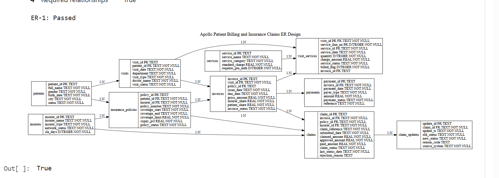
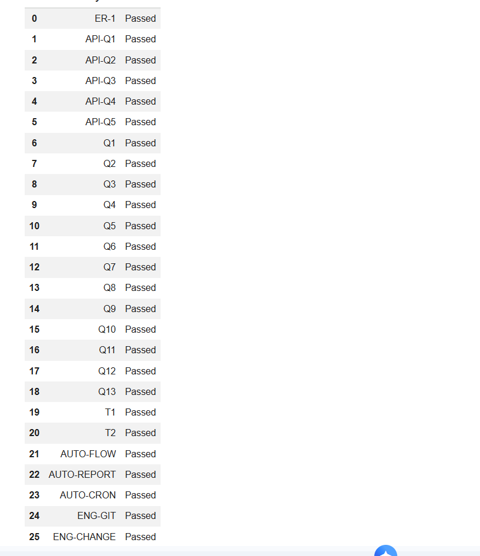

# Apollo Hospitals Billing & Insurance Claims Control Layer

**Business Impact:** An automated SQL control layer that identifies unbilled clinical services, tracks rejected insurance claims, and flags unpaid invoices to prevent hospital revenue leakage. Built to enforce ledger integrity across 1,300+ medical encounters.

## 📊 Key Audit Findings
* **Unbilled Revenue Leak:** Identified **118 unbilled service lines** (8.82% of 1,338 total lines) worth **₹6,00,500** in recoverable charges.
* **Insurer Rejection Variance:** PrimeCare recorded the highest observed rejection rate at **39.13%** (compared to Aarogya at 7.50%).
* **Open Audit Exceptions:** Flagged **652 open exceptions** across unbilled services, claim-to-invoice mismatches (₹250 to ₹16,600 variance), and unpaid balances.
* **Automated Validation:** 26 of 26 integrity, constraint, and reconciliation checks passed.

## 🛠️ Technical Implementation & Engineering Log
While the base schema was provided, the core reconciliation logic and transaction handling were independently built and debugged:
* **SQL & Data Modeling:** Multi-table `JOIN`s, Common Table Expressions (CTEs), Window Functions (`DENSE_RANK`, running totals), and `CHECK` constraints across a normalized 10-table schema.
* **ACID Transactions (T1/T2):** Implemented strict `COMMIT` and `ROLLBACK` logic to ensure atomic updates across claims and invoices (preventing partial ledger updates during claim rejection tests).
* **Exception Filtering (Q5):** Debugged and resolved edge cases in exception filtering to accurately isolate claim-to-invoice variance without triggering false positives.
* **Python & API Integration:** REST API ingestion and CRUD lifecycle testing via `requests`, orchestrated with SQLite.

## 📁 Documentation & Execution

### 1. Schema Design
*(Enforces PRIMARY KEY, FOREIGN KEY, and UNIQUE constraints, with deliberate denormalization of `insurer_id` on claims for audit query efficiency).*

### 2. Validation Output

---
### 🚀 Reproduce the Pipeline

